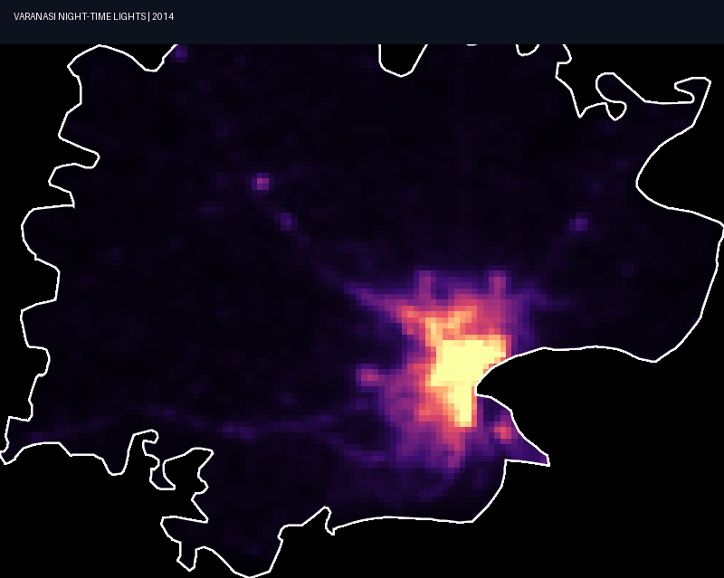
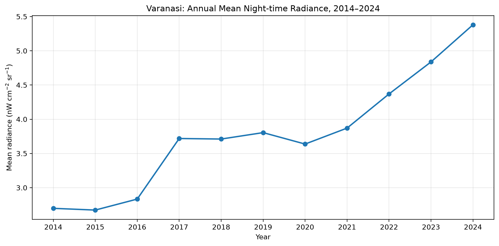

# Ayushi_UISA_2026
# Urban Informatics and Spatial Analytics - Test 2 Submission
**Student Name:** Ayushi Gill  
**Roll Number:** HS25M102

---

## Question 1: Interactive Web Mapping of Waste-Bin Observations
* **Interactive Map Link:** [View Hosted Waste-Bin Map](index.html) * (if not opening due to large size can also view at([url](https://hs25m102wastebins.netlify.app)). 
* **Description:** Displays the waste-bin observations collected via QField as interactive point features with custom popups showing field notes, timestamps, student attribution, and embedded base64 photographs. Uses CartoDB Light and Esri Satellite base layers.

---

## Question 2: Varanasi Night-time Lights Trend & Analysis (2014–2024)
* **Assigned City & Dataset:** Varanasi | VIIRS Night-time Lights (NOAA/VIIRS/DNB) + FAO GAUL Administrative Boundary.
* **Dynamic Output (GIF):** 
  
* **Numerical Results & Trend Graph:**
  
  * **2014 Baseline Mean Radiance:** 2.6981 nW cm⁻² sr⁻¹
  * **2024 Final Mean Radiance:** 5.3804 nW cm⁻² sr⁻¹
  * **Absolute Change:** +2.6822
  * **Percentage Increase:** +99.41%
* **Discussion & Interpretation:**
  The temporal analysis reveals a dramatic near-doubling (+99.41%) of average night-time radiance across Varanasi between 2014 and 2024. Spatially, intense growth radiates outward from the core urban center along major transit corridors, reflecting rapid urbanization, commercial expansion, and municipal lighting upgrades. 
  * **Limitations:** VIIRS DNB has a coarse spatial resolution (~464 m), which mixes urban surface radiance with surrounding peri-urban pixels. Cloud cover and stray light corrections were handled using monthly `cf_cvg` quality filters.
* **Boundary Source:** FAO GAUL (2025) Level 2 Administrative Boundaries.
